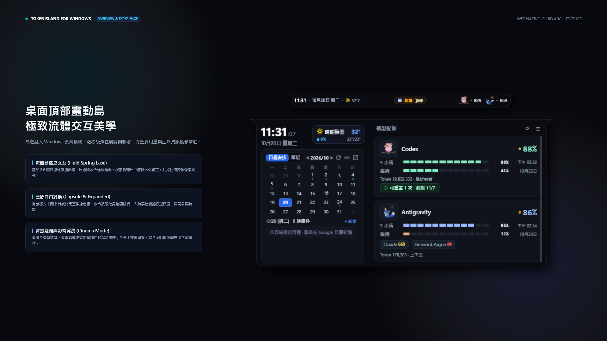
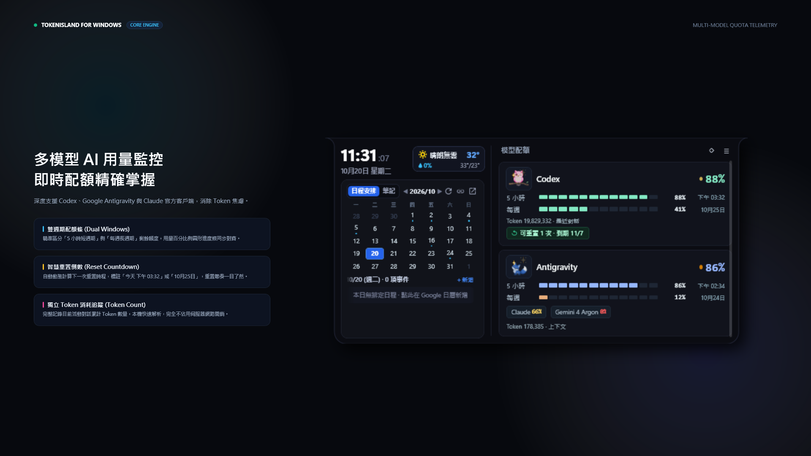
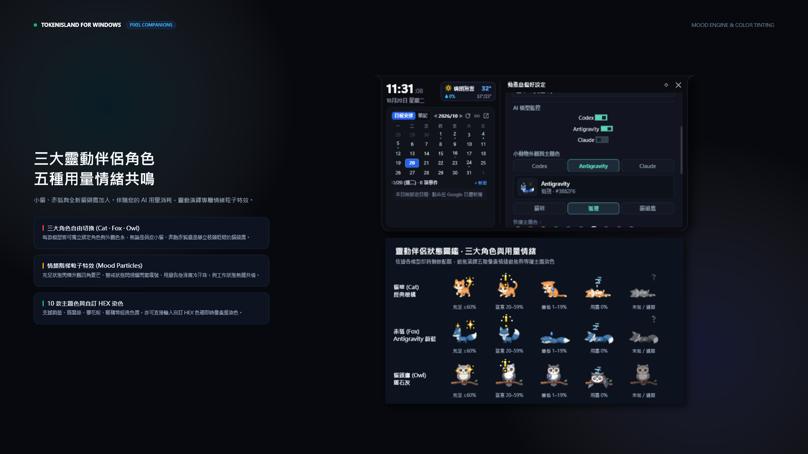
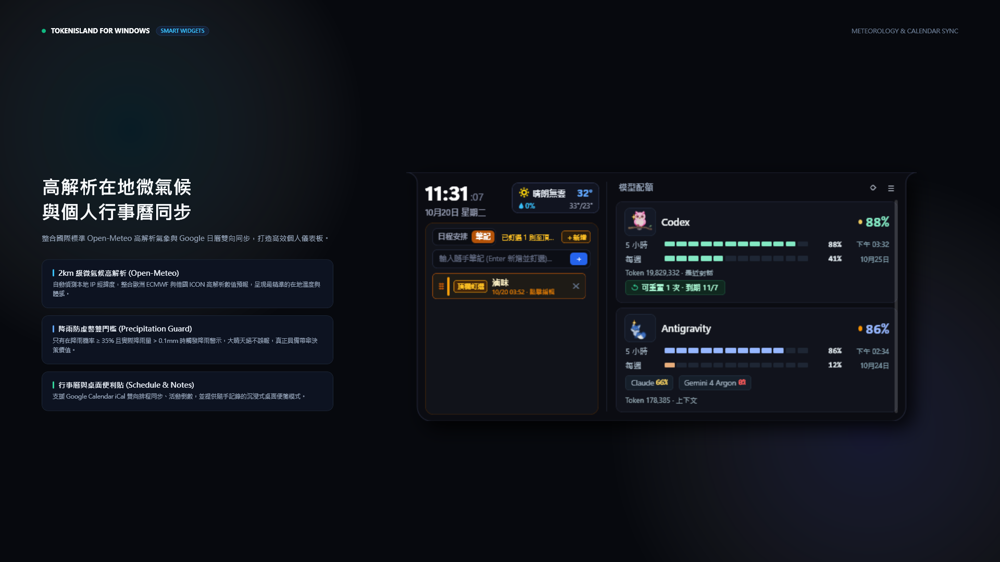
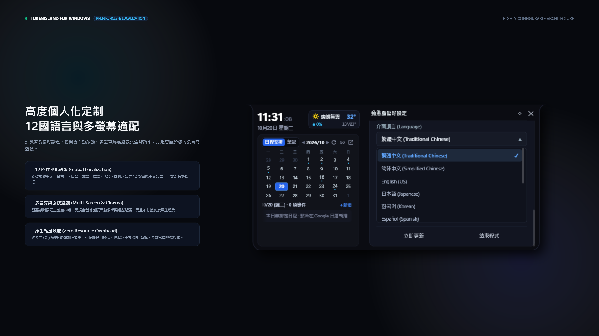

# TokenIsland for Windows

> 專為 Windows 10 / 11 打造的旗艦級頂部動態島 · AI 配額即時監控 · 靈動像素伴侶 · 在地微氣候與排程整合

[](https://github.com/lyh011403/TOKEN_ISLAND)
[](https://github.com/lyh011403/TOKEN_ISLAND)
[](LICENSE)

---

## 視覺導覽與核心功能

### 1. 桌面頂部靈動島 · 極致流體交互美學

- **原生流體動態島交互**：基於 3.6 階非線性減速曲線（Fluid Spring Ease-Out），展開與收合極致滑順；物理座標永久鎖定置中，杜絕任何跨幀像素跳動。
- **膠囊與展開雙態自由變換**：滑鼠移入平滑展開完整數據儀表板；收合狀態化身極簡膠囊，即時掌握關鍵模型額度、微氣象與時間。
- **智慧避讓與劇院沉浸模式**：偵測全螢幕遊戲、看電影或瀏覽器頂部自動沉浸避讓；全透明穿透邊界，完全不阻礙底層應用正常操作。

---

### 2. 多模型 AI 用量監控 · 即時配額精確掌握

- **支援主流官方客戶端**：深度支援 Codex、Google Antigravity 與 Claude 官方 Windows 桌面版。
- **雙週期配額條**：精準區分「5 小時短週期」與「每週長週期」剩餘額度，用量百分比與圖形進度條同步對齊。
- **智慧重置倒數**：自動動態計算下一次重置時程，標註「今天 下午 03:32」或「10月25日」，重置節奏一目了然。
- **獨立 Token 消耗追蹤**：完整記錄目前活動對話累計 Token 數量，本機快速解析，零額外伺服器網路開銷。

---

### 3. 三大靈動伴侶角色 · 五階用量情緒動態

- **三大角色自由切換**：
  - **貓咪 (Cat)** · 經典暖橘
  - **赤狐 (Fox)** · Antigravity 蔚藍
  - **貓頭鷹 (Owl)** · 曜石銀灰
- **情緒階梯粒子特效**：
  - **充足 $\ge 60\%$**：四角星芒閃爍升騰、貓頭鷹枝頭眨眼
  - **留意 20–59%**：頭頂爆閃驚嘆號警戒
  - **偏低 1–19%**：冷汗珠滑落警戒
  - **用盡 0%**：趴臥呼呼大睡 (Zzz)
  - **未知／過期**：靜態問號灰階
- **10 款主題色與自訂 HEX 染色**：支援蔚藍、翡翠綠、櫻花粉、暖橘等經典色票，亦可直接輸入自訂 HEX 色碼即時像素重染色。

---

### 4. 高解析在地微氣候 · 與個人行事曆同步

- **2km 級微氣候高解析**：自動偵測本地 IP 經緯度，整合歐洲 ECMWF 與德國 ICON 高解析數值預報，呈現最精準的在地溫度與體感。
- **降雨防虛警雙門檻**：只有在降雨機率 $\ge 35\%$ 且實際降雨量 $> 0.1\text{ mm}$ 時觸發降雨警示，大晴天絕不誤報，具備帶傘決策價值。
- **行事曆與桌面便利貼**：支援 Google Calendar iCal 雙向排程同步、活動倒數，並提供隨手記錄的沉浸式桌面便箋模式。

---

### 5. 高度個人化定制 · 12 國語言與多螢幕適配

- **12 國在地化語言**：支援繁體中文（台灣）、簡體中文、英語、日本語、韓語、德語、法語、西班牙語等 12 款國際主流語言，一鍵即時熱切換。
- **多螢幕與劇院避讓**：智慧吸附指定主副顯示器，支援全螢幕劇院自動淡出與遊戲避讓，完全不打擾沉浸專注體驗。
- **原生輕量效能**：純原生 C# / WPF 硬體加速渲染，記憶體佔用極低，收起狀態零 CPU 負擔，長駐常開無感流暢。

---

## 快速建置 (Build from Source)

本專案使用 Windows 原生 .NET Framework 4.8 編譯，無需安裝任何龐大依賴（如 Node.js、Python 或 Visual Studio 大型工作負載）。

### 建置指令
以 PowerShell 開啟專案根目錄，執行：
```powershell
powershell -ExecutionPolicy Bypass -File .\build.ps1
```
腳本將自動調用系統內建之 `csc.exe` 進行編譯與最佳化，生成可獨立運行的 `TokenIsland.exe`。

---

## 隱私與安全保證 (Privacy & Security)

- **本地優先架構**：所有使用者自訂偏好設定、Google Calendar 私人 iCal 網址、日程快取與桌面便箋資料，**全數隔離儲存於本機 `data/` 目錄中**。
- **零數據上傳**：本專案不設任何第三方統計伺服器，絕不收集或上傳使用者之聊天文字、個人憑證、行事曆日程或釘選筆記。
- **開源透明**：全專案原始碼開放審查，所有網路調用僅限官方公開端點（Open-Meteo 氣象數值預報、使用者自行設定之 Google iCal 私人網址）。

---

## 授權條款 (License)

本專案基於 [MIT License](LICENSE) 條款開源發布。
